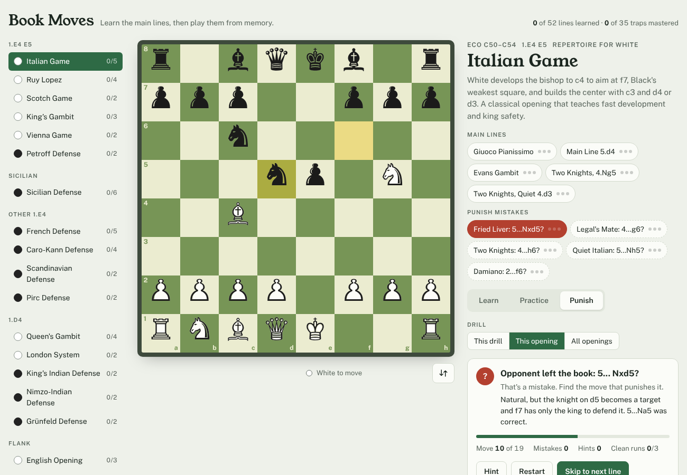

# Open to Punish

**Chess Opening Trainer** · *Learn the openings. Punish the mistakes.*

A chess opening trainer that runs entirely in your browser. Learn the main lines move by move, play them from memory, and practice punishing the mistakes opponents make when they leave the book.



## What's inside

- **17 openings, 52 main lines.** Italian, Ruy Lopez, Scotch, King's Gambit, Vienna, Petroff, Sicilian (Najdorf, Dragon, Sveshnikov, Taimanov, Alapin), French, Caro-Kann, Scandinavian, Pirc, Queen's Gambit and Slav, London, King's Indian, Nimzo-Indian, Grünfeld and English. Each move has a short explanation of why it's played.
- **35 mistake drills.** Classic traps like Legal's Mate, the Fried Liver, the Elephant Trap, the Lasker Trap and the Siberian Trap, plus engine-found punishments of natural-looking mistakes. Every drill was checked with Stockfish: after the right reply you are at least about 1.5 pawns better, usually winning outright.
- **Three modes**
  - **Learn:** step through a line with the arrow keys. A list shows every book move and known mistake from the current position, so you can branch into other variations.
  - **Practice:** the computer plays the book replies and you have to find your side's moves. Hints highlight the piece, then show an arrow.
  - **Punish:** the opponent leaves the book with a mistake and you have to find the refutation, then convert.
- **Progress tracking for several players.** Three clean runs (no mistakes, no hints) mark a line as learned. Each player on the device has their own progress.
- **Save and load.** Save a player's progress to a `.json` file and load it in another browser or on another computer.
- **English and Korean.** Switch with the EN / 한국어 toggle in the header. Every screen, opening name, summary and move explanation is translated. The choice is remembered on the device.
- **Three piece styles.** Classic, Totoy or Staunty, chosen under the board and saved for each player.
- **Works offline** and installs as an app. No account, no tracking, no build step.

## Run it locally

**Quickest:** download or clone the repo and double-click `index.html`. Everything, including fonts and the chess library, is bundled, so it works without an internet connection.

**As an installable app:** serving the folder over `http://localhost` lets the browser install it and cache it for offline use. With [Node.js](https://nodejs.org) 18 or newer:

```sh
git clone https://github.com/<you>/open-to-punish.git
cd open-to-punish
npm start
```

Then open <http://localhost:8080>. In Chrome or Edge, click the install icon in the address bar. In Safari on macOS, choose **File → Add to Dock**. On iPhone or Android, open the GitHub Pages site and choose **Add to Home Screen**.

No `npm install` is needed: the project has no dependencies.

## Players and saving progress

Click the player button in the top right corner to add players, switch between them, rename them or delete them. Progress is saved automatically in the browser you're using.

Progress stays in that one browser, and opening `index.html` directly, `localhost:8080` and the GitHub Pages site each keep separate progress. To move progress somewhere else, or to back it up, use **Save to file**, then **Load from file** on the other side. Loading a file for a player who already exists merges the two: for each line, the better result is kept, so nothing is lost. A file for a new name creates that player.

## Publish on GitHub Pages

1. Push this repo to GitHub with `main` as the default branch.
2. In the repo, open **Settings → Pages** and set **Source** to **GitHub Actions**.
3. The workflow in `.github/workflows/pages.yml` checks every line with `npm test` and deploys. Your trainer will be live at `https://<you>.github.io/open-to-punish/`.

## Add your own lines

Openings live in `data/book.js` and mistake drills in `data/traps.js`. Moves are written in standard algebraic notation, and a `{comment}` after a move explains it.

```js
{ name:"Exchange Variation",
  moves:"e4 e6 d4 d5 exd5 {White releases the tension.} exd5 Nf3 Nf6" }
```

A mistake drill marks the opponent's mistake with `?` and the refutation with `!`, and says what you win:

```js
{ name:"Frankenstein: 4...Nf6??", gain:"Checkmate on move 5.",
  moves:"e4 e5 Nc3 Nf6 Bc4 Nxe4 Qh5 Nf6? {Forgets f7.} Qxf7#" }
```

Add `side:"b"` to a drill when the player punishing the mistake is Black but the opening is normally played as White, or the reverse.

Add the Korean for anything new in `data/ko.js`: the line name (and result, for drills) under `lines["<opening id>/<English name>"]`, and each move comment under `notes`, keyed by the English text.

Run `npm test` before committing. It plays through every line and reports any illegal move, missing `?` mark, duplicate name or missing Korean translation.

After changing any file, bump `VERSION` in `sw.js` so installed copies pick up the update.

## Project layout

```
index.html              page markup
css/app.css             styles, light and dark themes
js/app.js               board, Learn / Practice / Punish logic
js/pieces.js            Classic piece shapes (SVG paths)
pieces/totoy, staunty/  Totoy and Staunty piece files, each with its LICENSE.txt
js/piece-sets.js        those files packed for offline use (tools/build-piece-sets.js)
data/book.js            opening lines
data/traps.js           mistake drills
data/ko.js              Korean translations of the opening content
js/i18n.js              interface text in English and Korean
vendor/chess.js         move generation and validation (chess.js 0.10.3)
fonts/                  bundled Figtree font
sw.js, manifest.webmanifest, icons/   offline support and app install
tools/validate.js       npm test: checks every line
tools/serve.js          npm start: local server
```

## License

MIT for the app code and opening data. chess.js is BSD 2-Clause; the Figtree font and the Classic piece shapes (from Noto Sans Symbols 2) are under the SIL Open Font License. See `LICENSE`.

Piece styles:
- **Totoy** by Kosal Sen, [CC BY 4.0](https://creativecommons.org/licenses/by/4.0/).
- **Staunty** by sadsnake1, [CC BY-NC-SA 4.0](https://creativecommons.org/licenses/by-nc-sa/4.0/). Non-commercial only: while the project includes `pieces/staunty`, it may not be used commercially. Delete that folder and run `node tools/build-piece-sets.js` to remove it.

Both sets are included unchanged from [Lichess](https://github.com/lichess-org/lila).
